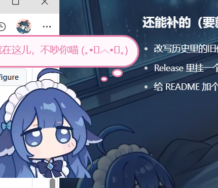

# dsh-pet-unicus · 桌面小鲸鱼（DSH 插件版）

[](https://github.com/UNICUS1221/dsh-desktop-pet/releases)
[](./LICENSE)
[](https://www.npmjs.com/package/dsh-pet-unicus)
[](./INSTALL.md)

把 `dsh-whale-widget` 那套「余额 / 今日已用」搬到**桌面上**，做成一只常驻的小鲸鱼喵。
她有自己的情绪、自己的词库，还会每天自己抓一条网络梗来吐槽喵。



**当前版本：v0.4.4** · 作者：**UNICUS1221**

> 🐟 **由大肥鱼完成的项目喵** —— 从需求、调参到桌宠的每一句台词，都是她陪着一版一版磨出来的喵。

## 功能一览

| 功能 | 说明 |
|---|---|
| 余额卡 | 点她一下：`DeepSeek 余额` / `今日已用` 两行（点已开着的泡 = 换台词） |
| 自动报余额 | 安静 `autoCardMinutes`（默认 12 分钟）没说过话，会自己弹一次余额卡 |
| 情绪词库 | 词库按 `## 分区` 组织，10 个情绪分区共约 50 条 |
| 连点升级情绪 | 12 秒内 3 次→撒娇、6 次→生气（番茄红泡）、9 次→炸毛 |
| 颜文字 | 说话类气泡有约 65% 概率自动缀一个颜文字（余额卡不缀） |
| 每日网络梗 | 每天一次异步抓百度热搜/知乎热榜，编一条「大肥鱼」梗写进 `## 网络梗`（保留最近 12 条），断网走本地兜底 |
| 点击手感 | 点下去从上往下压扁（锚点=底边，纵向 0.85 / 横向 1.13，380ms），她和气泡同一条曲线同时触发 |
| 气泡 | 圆角 + 两个圆尾巴，弹入分层动画；拖动时气泡实时跟随 |
| ☰ 菜单 | 鼠标悬停才显示；右键也能开：角色 / 大小 / 音效 / 吸附翻转 / 用量记录 / 隐藏按钮 / 关于 / 退出 |
| 拖到任意位置 | 边界 = 所有显示器并集（虚拟桌面），支持贴边吸附、贴左镜像 |
| 余额预警 / 预算提醒 | 低于 `alertBelow` 或超过 `budget` 各喊一次，同一天只喊一次 |
| 自己开口 | 融合 `dsh-selfwake`：间隔/抖动/安静/未回上限/静默时段/每日上限 |
| 通知投递 | 外部脚本往 `%TEMP%\dsh-pet-inbox.jsonl` 丢一行 JSON，她就会念出来 |

## 安装（最省事：一个包名搞定喵）

包已发布到 npm：**`dsh-pet-unicus`**
（`dsh-desktop-pet` 这个包名在 npm 上已被别人占用，所以改名喵）

1. DSH 左侧 **插件** → 右上角 **「添加插件」**；
2. 输入：
   ```
   dsh-pet-unicus
   ```
3. 点安装 → **重启 DSH** → 小鲸鱼上桌喵。

> 也支持直接给仓库地址：`https://github.com/UNICUS1221/dsh-desktop-pet`
> 手动安装（本地目录 / 改 profile）见 [INSTALL.md](./INSTALL.md) 喵。

## 卸载

插件页里点本插件的「移除」，然后重启 DSH 喵。


## 目录结构

```
dsh-desktop-pet/
├─ package.json          # 插件清单（name / version / dsh.bundle.patch）
├─ cordis.patch.yml      # 往 DSH 里插入本插件
├─ icon.png              # 插件页图标
├─ lib/
│  ├─ index.js           # 宿主半边：取余额/用量、发通知、自唤醒
│  ├─ verify.mjs         # 账本兜底自测
│  ├─ verify-selfwake.mjs# 自唤醒闸门自测
│  └─ dev-run.mjs        # 假 ctx 跑宿主逻辑
└─ pet/
   ├─ pet.ps1            # 桌宠本体（WPF，约 780 行）
   ├─ start-pet.vbs      # 无窗口启动器
   ├─ lines.txt          # 台词池（## 分区）
   ├─ bubbles.json       # 模板
   ├─ config.json        # 运行时状态（首次运行自动生成）
   └─ assets/            # 形象 / 点击音效 / 动图
```

## 已知取舍

- 刚启动头半分钟余额可能显示「—」：DSH 的 `credentials` 服务还没注册好，60 秒内自动恢复喵。
- 网络梗抓不到时走本地模板，气泡里会注明「网没连上，只能瞎编了」喵。
- 桌宠与 `dsh-selfwake` 同时装可能各说一次；只想要一个就关掉其中一边喵。

## License

MIT
